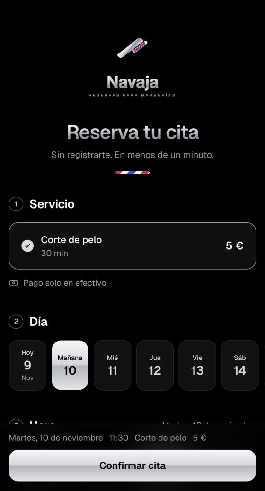
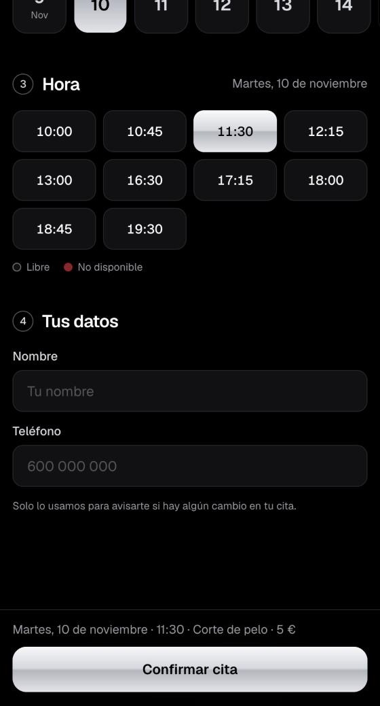
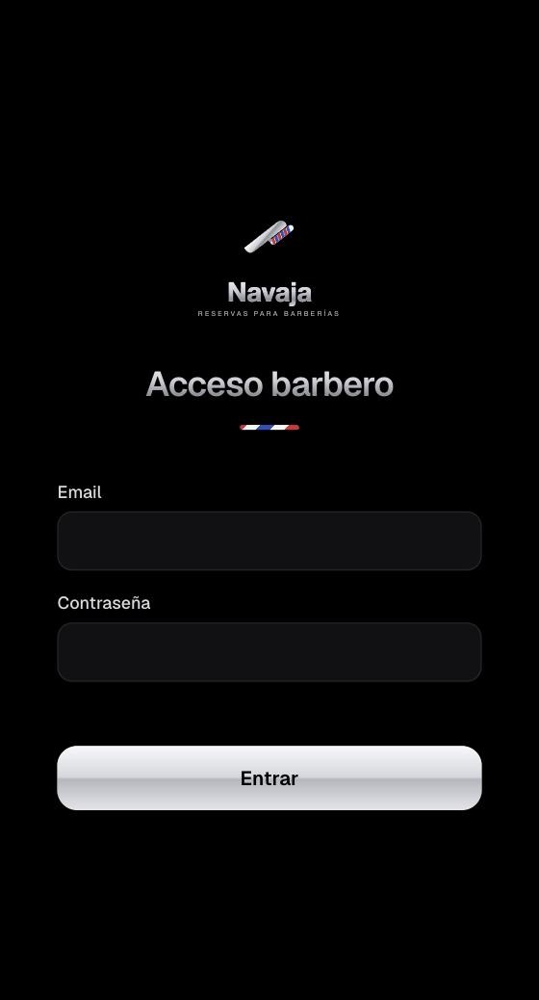
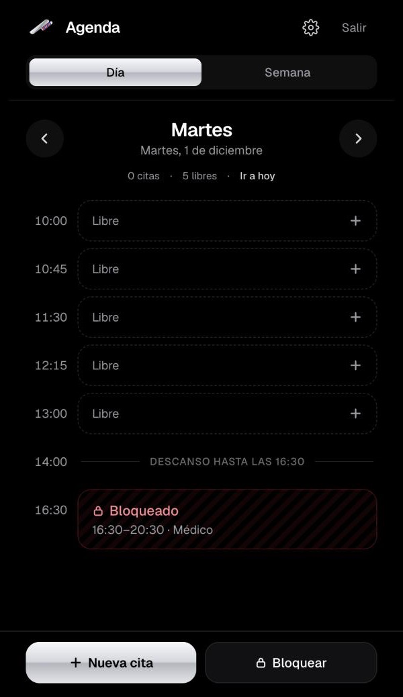
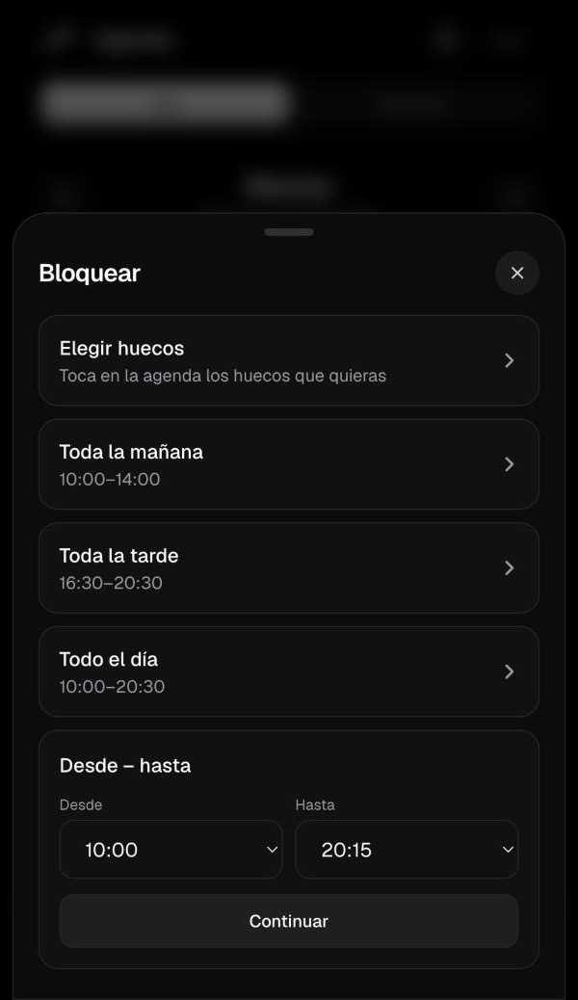
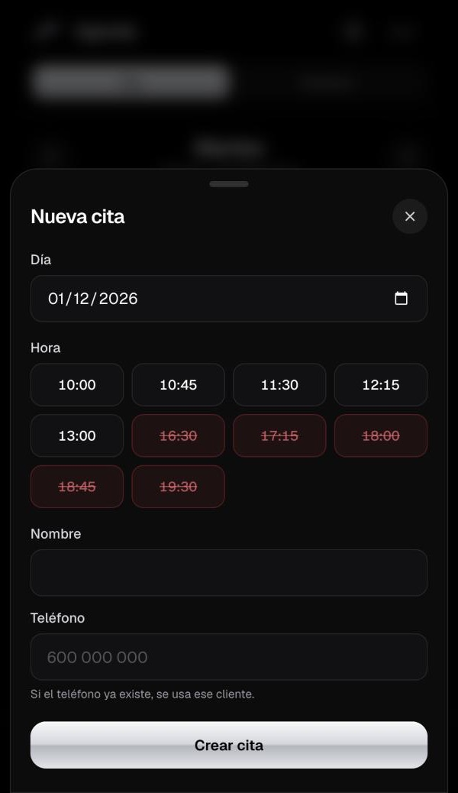
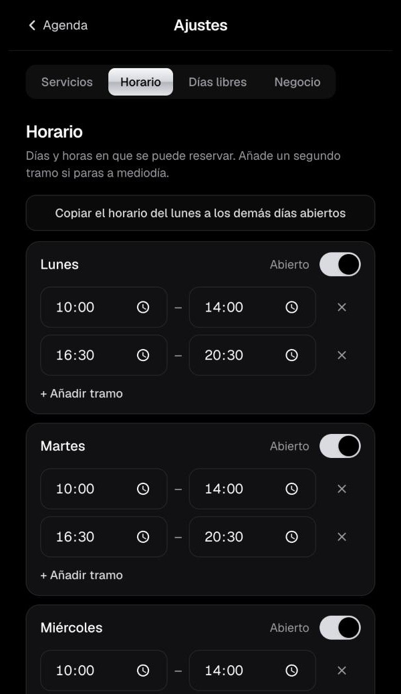

  

<strong>Reservas online para barberías.</strong> Tus clientes reservan solos, en un minuto y desde el móvil. Tú solo cortas el pelo.

---

## El problema

Casi todas las barberías pequeñas llevan las citas igual: mensajes de WhatsApp, llamadas en mitad de un corte y una libreta o la memoria del barbero. Eso trae citas que se olvidan, dos clientes a la misma hora, huecos que se quedan vacíos y un móvil que no para de sonar.

## La solución

**Navaja** es una web de reservas hecha solo para barberías, con la marca de tu negocio (tu nombre y tu logo).

- **Tus clientes** abren tu enlace, eligen servicio, día y hora libre, dejan su nombre y su teléfono, y listo. No tienen que registrarse ni descargarse nada.
- **Tú** ves tu agenda en el móvil, apuntas también las citas que te llegan por WhatsApp y bloqueas las horas en las que no puedes atender.

  
  &nbsp;
  
  &nbsp;
  

## Qué incluye

### Para tus clientes
- Reserva en 4 pasos: **servicio → día → hora → nombre y teléfono**.
- Solo se ven las horas libres. Las ocupadas o bloqueadas salen en rojo y no se pueden coger.
- Sin crear cuenta y sin descargar ninguna app: funciona en cualquier móvil.
- Pantalla de confirmación con el resumen de la cita y botones para **llamar o escribir por WhatsApp** a la barbería si quieren cambiarla.
- Aviso de forma de pago (por ejemplo, «Pago solo en efectivo»).

### Para el barbero
- **Agenda del día y de la semana**, pensada para consultarla entre corte y corte.
- **Nueva cita en dos toques** para quien escribe por WhatsApp o pasa por la puerta. Si el teléfono ya existe, se usa el mismo cliente.
- **Cambiar la hora, cancelar** o marcar una cita como **completada / no vino**.
- **Bloquear huecos**: toda la mañana, toda la tarde, el día entero, unas horas sueltas… Si ya hay citas en ese rato, te avisa.
- **Días libres y vacaciones** de una vez.
- **Ajustes sin tocar código**: servicios y precios, horario con descanso a mediodía, cada cuánto empiezan las citas y con cuánta antelación se puede reservar.
- Llamar o escribir por WhatsApp a cada cliente desde su cita, con el mensaje ya escrito.

  
  &nbsp;
  
  &nbsp;
  
  &nbsp;
  

Agenda del día · Bloquear huecos · Nueva cita · Horario

### Seguro y sin sorpresas
- **Nunca dos citas a la vez**: lo impide la propia base de datos, aunque dos clientes pulsen «Reservar» en el mismo segundo.
- **Privacidad**: un cliente no puede ver las citas ni los teléfonos de nadie. Las reglas de seguridad están en la base de datos, no solo en la web.
- Solo el barbero entra en su panel, con email y contraseña.
- Freno básico contra reservas falsas: como mucho 2 citas pendientes por teléfono.

## Diseño

Limpio y profesional, con animaciones suaves y pensado primero para el móvil. Cada barbería lleva **su propio logo y su nombre**: Navaja queda por detrás.

## Tecnología

Hecha con herramientas modernas y fiables, sin cuotas de licencia:

| | |
|---|---|
| Web | Next.js 16 · React · TypeScript · Tailwind CSS |
| Datos y acceso | Supabase (PostgreSQL + Auth) con reglas de seguridad por fila (RLS) |
| Publicación | Vercel |

La base de datos tiene pruebas automáticas de seguridad (quién puede ver qué), de huecos y de reservas.

## Estado

✅ **Primera versión terminada y funcionando en su primera barbería.**

Próximamente: recordatorios por WhatsApp o email, estadísticas de la semana y del mes, historial de cada cliente y varios barberos en la misma barbería.

## ¿La quieres para tu barbería?

Te la dejo montada con tu nombre, tu logo, tus servicios y tu horario, y te enseño a usarla.

👉 **Abre un [issue en este repositorio](../../issues/new)** contando cómo se llama tu barbería y te escribo.

---

El código es privado. Este repositorio solo presenta el producto. Hecho por <a href="https://github.com/mxso00">mxso00</a>.
